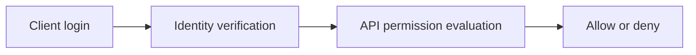
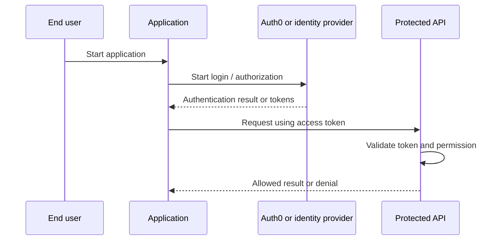
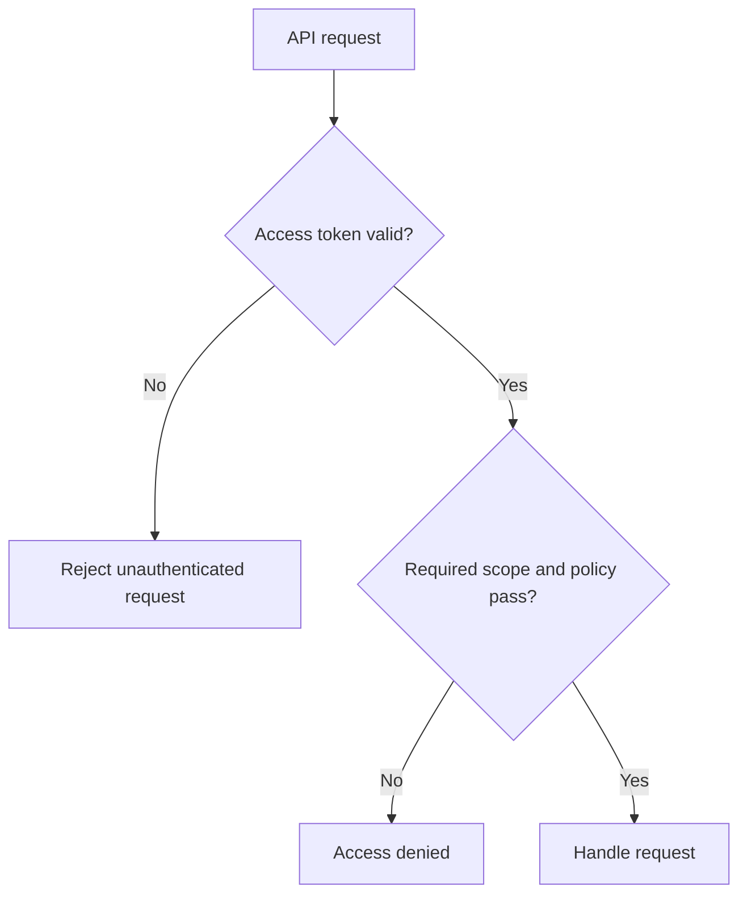

# Authentication vs Authorization — Explained Simply

*OAuth and Identity Study Library · Author: Jayesh Sharma*

**Based on:** [Auth0 Docs — Authentication vs Authorization](https://auth0.com/docs/get-started/identity-fundamentals/authentication-and-authorization)

## Contents

- [What this section teaches](#what-this-section-teaches)
- [Simple analogy](#simple-analogy)
- [The core architecture](#the-core-architecture)
- [Authentication](#authentication)
- [Authorization](#authorization)
- [401 vs 403](#401-vs-403)
- [Access token vs ID token](#access-token-vs-id-token)
- [Practical example](#practical-example)
- [Trust boundary](#trust-boundary)
- [Practical learning exercise](#practical-learning-exercise)
- [Common mistakes and interview questions](#common-mistakes-and-interview-questions)

## What this section teaches

**The two questions every identity system asks.** Authentication establishes identity; authorization decides access. A user can sign in successfully and still be forbidden from deleting someone else's records.

The central idea is to recognize the **identity**, **application**, **authorization server**, **resource server**, and **trust boundaries**. These concepts remain useful whether your implementation is Java/Spring Boot, C++, C#, Python or a web application.

## Simple analogy

At an airport, an ID check identifies the passenger while the boarding pass and gate controls decide whether the passenger may board.

The analogy does not replace real token validation, session protection or authorization checks.

## The core architecture

## Authentication

Check evidence such as a password, authenticator or federated identity. A success establishes an authenticated principal and a session or token.

**Think about it:** What might fail if the caller uses a valid credential but requests the wrong audience, scope or resource?

## Authorization

Apply permissions, roles, resource ownership and other rules to each relevant operation. Logging in does not imply administrator access.

**Think about it:** What might fail if the caller uses a valid credential but requests the wrong audience, scope or resource?

## 401 vs 403

An API typically returns 401 when a valid authentication credential is missing or unacceptable, and 403 when the caller is authenticated but not allowed to perform the operation.

**Think about it:** What might fail if the caller uses a valid credential but requests the wrong audience, scope or resource?

## Access token vs ID token

Access tokens are meant for resource servers; ID tokens are meant for the OIDC client to understand an authentication event.

**Think about it:** What might fail if the caller uses a valid credential but requests the wrong audience, scope or resource?

## Practical example

A signed-in employee can read their expense reports but cannot approve someone else's reimbursement unless policy permits it.

**Think about it:** What might fail if the caller uses a valid credential but requests the wrong audience, scope or resource?

## Trust boundary

Authenticate at the right entry point and enforce authorization on the server. Never rely only on hidden UI buttons.

**Think about it:** What might fail if the caller uses a valid credential but requests the wrong audience, scope or resource?

## Practical learning exercise

1. Draw the actors and label which component authenticates and which component authorizes.
2. Register an application and API in a safe Auth0 development tenant only if needed.
3. Configure exact callback URLs and requested scopes; never paste client secrets or access tokens into public repositories.
4. Test a valid login, an expired token, a wrong-audience token and an insufficient-permission request.
5. Compare application logs with expected 401/403 behavior and avoid logging sensitive data.

## Common mistakes and interview questions

| Common mistake | Better approach |
|---|---|
| Confusing a signed-in user with a fully authorized user | Check permissions per operation |
| Using ID tokens as API bearer tokens | Validate an access token with correct audience |
| Putting secrets in a public client | Use appropriate public-client OAuth flow with PKCE |
| Trusting a decoded JWT without verification | Validate signature, issuer, audience and expiry |
| Hardcoding everything into a demo | Separate application registration, roles and APIs |

**Practice:** Explain authentication vs authorization in 60 seconds. Who is authenticated? What resource is protected? Which service enforces access? What error is expected when permission is missing?

**Source:** https://auth0.com/docs/get-started/identity-fundamentals/authentication-and-authorization
