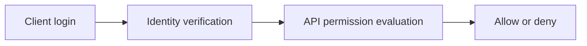
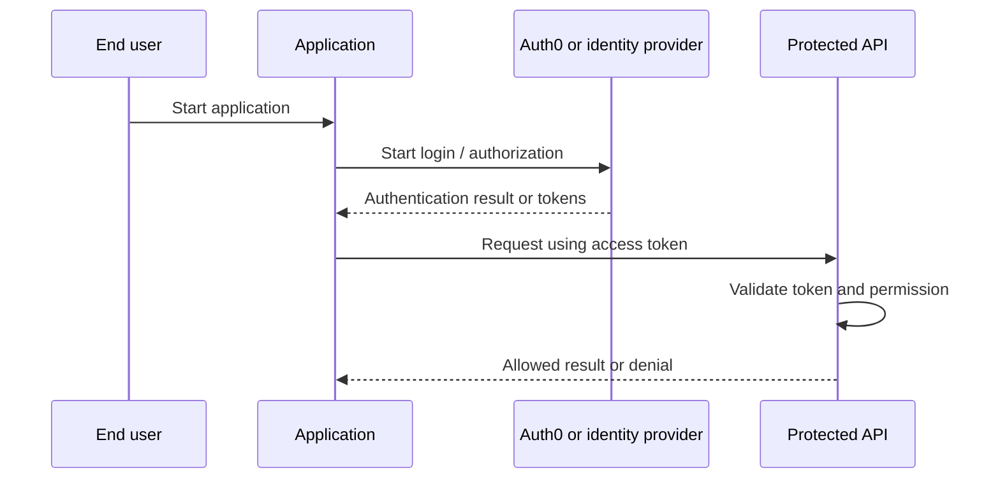
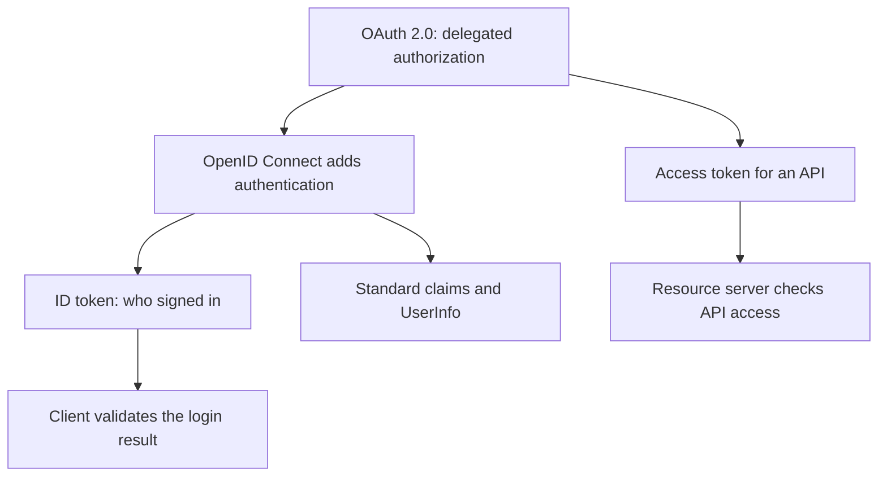
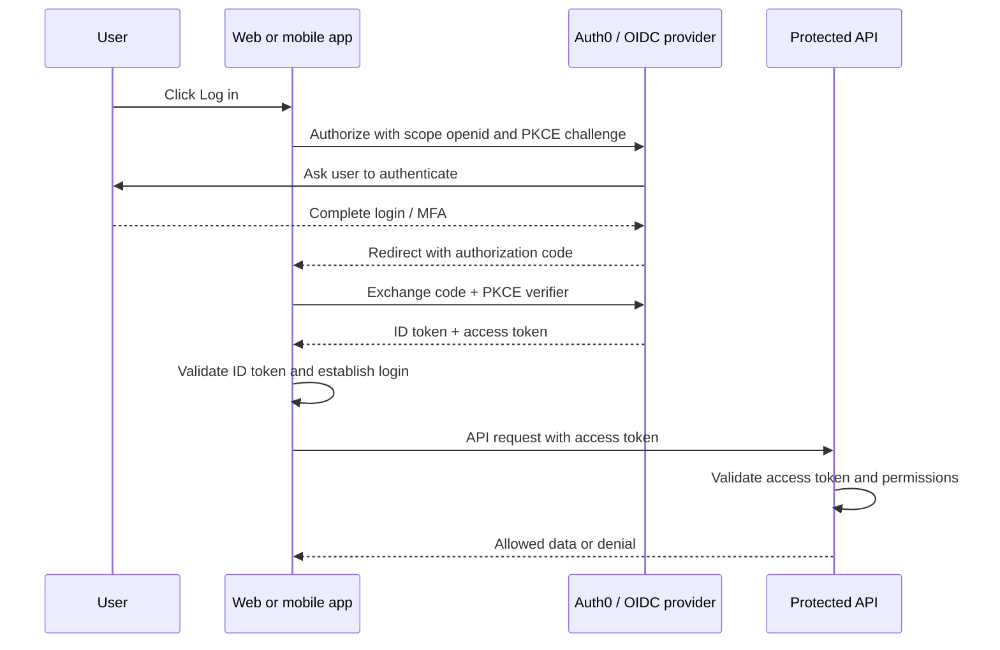
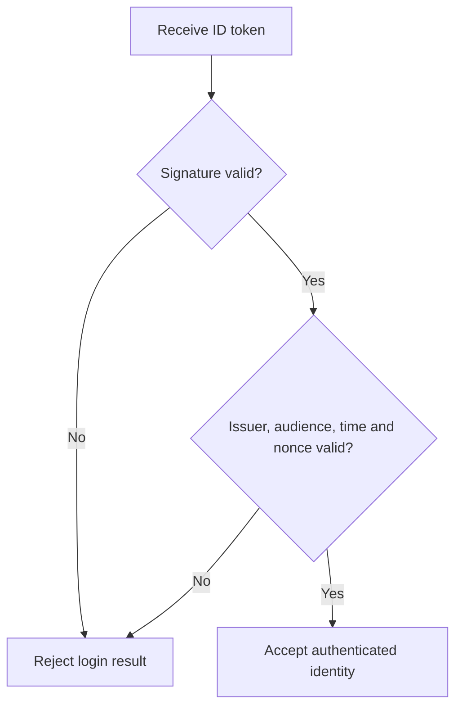
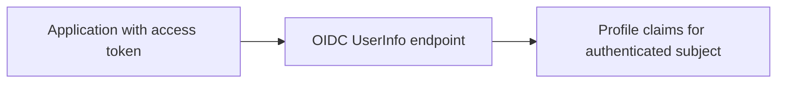
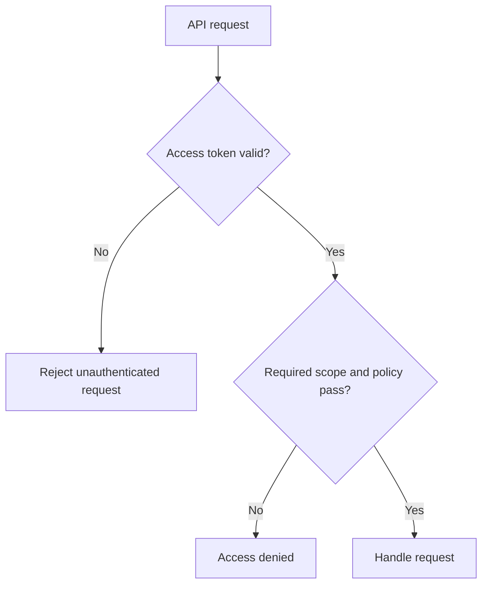

# Authentication vs Authorization — Explained Simply

*OAuth and Identity Study Library · Author: Jayesh Sharma*

**Based on:** [Auth0 Docs — Authentication vs Authorization](https://auth0.com/docs/get-started/identity-fundamentals/authentication-and-authorization)

## Contents

- [What this section teaches](#what-this-section-teaches)
- [Simple analogy](#simple-analogy)
- [The core architecture](#the-core-architecture)
- [Authentication](#authentication)
- [Authorization](#authorization)
- [401 vs 403](#401-vs-403)
- [Access token vs ID token](#access-token-vs-id-token)
- [What is OpenID Connect (OIDC)?](#what-is-openid-connect-oidc)
- [OAuth 2.0 vs OIDC vs authorization](#oauth-20-vs-oidc-vs-authorization)
- [OIDC login flow step by step](#oidc-login-flow-step-by-step)
- [Understanding the ID token](#understanding-the-id-token)
- [OIDC scopes and UserInfo](#oidc-scopes-and-userinfo)
- [OIDC security and common mistakes](#oidc-security-and-common-mistakes)
- [Practical example](#practical-example)
- [Trust boundary](#trust-boundary)
- [Practical learning exercise](#practical-learning-exercise)
- [Common mistakes and interview questions](#common-mistakes-and-interview-questions)

## What this section teaches

**The two questions every identity system asks.** Authentication establishes identity; authorization decides access. A user can sign in successfully and still be forbidden from deleting someone else's records.

The central idea is to recognize the **identity**, **application**, **authorization server**, **resource server**, and **trust boundaries**. These concepts remain useful whether your implementation is Java/Spring Boot, C++, C#, Python or a web application.

## Simple analogy

At an airport, an ID check identifies the passenger while the boarding pass and gate controls decide whether the passenger may board.

The analogy does not replace real token validation, session protection or authorization checks.

## The core architecture





## Authentication

Check evidence such as a password, authenticator or federated identity. A success establishes an authenticated principal and a session or token.

**Think about it:** What might fail if the caller uses a valid credential but requests the wrong audience, scope or resource?

## Authorization

Apply permissions, roles, resource ownership and other rules to each relevant operation. Logging in does not imply administrator access.

**Think about it:** What might fail if the caller uses a valid credential but requests the wrong audience, scope or resource?

## 401 vs 403

An API typically returns 401 when a valid authentication credential is missing or unacceptable, and 403 when the caller is authenticated but not allowed to perform the operation.

**Think about it:** What might fail if the caller uses a valid credential but requests the wrong audience, scope or resource?

## Access token vs ID token

Access tokens are meant for resource servers; ID tokens are meant for the OIDC client to understand an authentication event.

**Think about it:** What might fail if the caller uses a valid credential but requests the wrong audience, scope or resource?

## What is OpenID Connect (OIDC)?

**OIDC stands for OpenID Connect.** It is a standard protocol that lets an application **verify who has signed in** by using an identity provider such as Auth0, Google, or Microsoft Entra ID.

**Very simple analogy:** A visitor arrives at an office:

- **Authentication:** The receptionist checks the visitor's identity.
- **OIDC:** The receptionist gives the office a trusted identity slip saying **who was verified**.
- **OAuth 2.0:** A separate permission pass gives an application limited access to an API.
- **Authorization:** The door controller decides whether the visitor is actually allowed into the particular room.

OIDC builds **on top of OAuth 2.0**. It does not replace OAuth; it adds a standardized authentication layer and defines an **ID token**.

### Why was OIDC needed?

OAuth 2.0 was built for **delegated authorization**, not to tell a client application, in a standard way, who the user is.

Imagine a photo editor needs permission to read some photos from another service. OAuth provides a way to request an access token for that purpose. But possessing that token is not the same as receiving a standardized, verifiable statement of the user's identity.

OIDC adds that identity statement, usually through a signed **ID token (JWT)**.



**Remember:** **OAuth = permission to access a resource. OIDC = standardized proof of user authentication.** Your application's own authorization rules still decide which business operations the user may perform.

## OAuth 2.0 vs OIDC vs authorization

| Concept | Simple question | Primary artifact | Who uses it? |
|---|---|---|---|
| Authentication | Who are you? | Authenticated session or identity result | Identity provider and client |
| OAuth 2.0 | May this client call a protected API? | Access token | Client and resource server |
| OIDC | Which user signed in, according to the identity provider? | **ID token** | Client application |
| App authorization | Can this user edit **this** record? | Server-side permission decision | Application/API |

**Example — online shopping application:**

1. You click **Log in with Google**.
2. Google authenticates you.
3. The application uses **OIDC** to learn your verified user identity via a validated ID token.
4. If the application needs to call a protected API, it obtains and presents an **access token** for that API.
5. The shopping API checks the access token **and** its business authorization rules before allowing you to view or change an order.

Signing in does not mean you may read **everyone's orders**.

## OIDC login flow step by step

A common modern setup uses **Authorization Code Flow with PKCE**.

1. The user clicks **Log in** in the application.
2. The application redirects the browser to the identity provider's authorization endpoint. The request includes `scope=openid`, a client ID, a registered redirect URI, state, and PKCE parameters.
3. Auth0 authenticates the user, using an appropriate method such as password, social identity or MFA.
4. The browser returns to the application's registered callback with a **short-lived authorization code**.
5. The application exchanges that code at the token endpoint, presenting its PKCE verifier and any client authentication required for its client type.
6. Auth0 returns an **ID token** and, when applicable, an **access token**; a refresh token is optional.
7. The application **validates the ID token** and establishes its own authenticated session or client login state.
8. When it calls a protected API, it uses the **access token**, not the ID token. The API checks its audience and permissions.



**Important:** This is a conceptual message flow. In a real browser redirect, the authorization code returns **through the user agent**; tokens are exchanged through the appropriate token endpoint.

## Understanding the ID token

An **ID token** is a **JWT** containing signed claims about the authentication event. It tells the client which identity the provider authenticated.

Example payload (**illustrative only**, not a real usable token):

```json
{
  "iss": "https://example.auth0.com/",
  "sub": "auth0|user-123",
  "aud": "my-client-id",
  "iat": 1793500000,
  "exp": 1793503600,
  "email": "alice@example.com",
  "email_verified": true
}
```

| Claim | Meaning |
|---|---|
| `iss` | **Issuer:** which provider issued the ID token |
| `sub` | **Subject:** stable identity identifier **within that issuer** |
| `aud` | **Audience:** which client application this ID token is for |
| `iat` | When the token was issued |
| `exp` | When the token expires |
| `nonce` | Binds the authentication response to a request when a nonce was supplied |
| `email` | User email, if requested and provided |
| `email_verified` | Whether the provider reports the email as verified |

**A JWT has three encoded parts** separated by periods: header, payload, and signature. Decoding its payload is **not validation**. The client must verify the signature and expected issuer/audience, expiration, and nonce where applicable.



**Never send an ID token to a business API as the API's bearer access token.** The API needs an **access token intended for that resource**, plus application-specific authorization.

## OIDC scopes and UserInfo

You can request standard OIDC scopes in the authorization request:

```text
scope=openid profile email
```

- `openid`: **Required** to request OpenID Connect authentication.
- `profile`: Requests standard basic profile claims, such as name and picture, when available.
- `email`: Requests email-related claims, subject to provider policies and consent.

The **UserInfo endpoint** is another OIDC feature. An application may call it with an appropriate **access token** to retrieve identity claims when needed.



Do not confuse a UserInfo access token with a token granting permission to your own order-management or banking API. Token audience and intended resource still matter.

## OIDC security and common mistakes

- Use **Authorization Code with PKCE** for modern interactive web, SPA and native integrations when applicable.
- Verify ID token signature with the provider's trusted keys and verify `iss`, `aud`, `exp` and `nonce` as required.
- Use `state` and exact registered redirect URIs to protect authorization responses.
- Do not treat `email` as a globally unique permanent user ID. Prefer issuer plus `sub`.
- A valid login does **not** authorize a user to read another user's data.
- An access token is for its intended API; an ID token is for the client.
- Do not expose client secrets in mobile applications or browser-side code.
- Use HTTPS and secure session/token storage; avoid logging tokens.

**Three interview questions:**

1. **Why does OIDC exist if OAuth 2.0 already issues tokens?** Because OAuth doesn't standardize how a client verifies an end user's authentication; OIDC supplies the ID token and identity claims.
2. **Can an ID token be used to call a REST API?** Not as the business API's bearer access token. Use a suitable access token.
3. **Does OIDC replace authorization checks?** No. The API still enforces permissions and resource ownership.

**Official reading:**

- [Auth0: What is OpenID Connect?](https://auth0.com/intro-to-iam/what-is-openid-connect-oidc)
- [Auth0: Authentication vs Authorization](https://auth0.com/intro-to-iam/authentication-vs-authorization)
- [OpenID Connect Core specification](https://openid.net/specs/openid-connect-core-1_0.html)

## Practical example

A signed-in employee can read their expense reports but cannot approve someone else's reimbursement unless policy permits it.

**Think about it:** What might fail if the caller uses a valid credential but requests the wrong audience, scope or resource?

## Trust boundary

Authenticate at the right entry point and enforce authorization on the server. Never rely only on hidden UI buttons.

**Think about it:** What might fail if the caller uses a valid credential but requests the wrong audience, scope or resource?

## Practical learning exercise

1. Draw the actors and label which component authenticates and which component authorizes.
2. Register an application and API in a safe Auth0 development tenant only if needed.
3. Configure exact callback URLs and requested scopes; never paste client secrets or access tokens into public repositories.
4. Test a valid login, an expired token, a wrong-audience token and an insufficient-permission request.
5. Compare application logs with expected 401/403 behavior and avoid logging sensitive data.



## Common mistakes and interview questions

| Common mistake | Better approach |
|---|---|
| Confusing a signed-in user with a fully authorized user | Check permissions per operation |
| Using ID tokens as API bearer tokens | Validate an access token with correct audience |
| Putting secrets in a public client | Use appropriate public-client OAuth flow with PKCE |
| Trusting a decoded JWT without verification | Validate signature, issuer, audience and expiry |
| Hardcoding everything into a demo | Separate application registration, roles and APIs |

**Practice:** Explain authentication vs authorization in 60 seconds. Who is authenticated? What resource is protected? Which service enforces access? What error is expected when permission is missing?

**Source:** https://auth0.com/docs/get-started/identity-fundamentals/authentication-and-authorization
