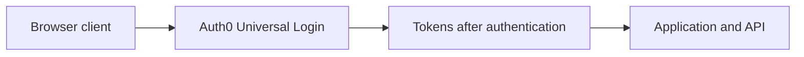
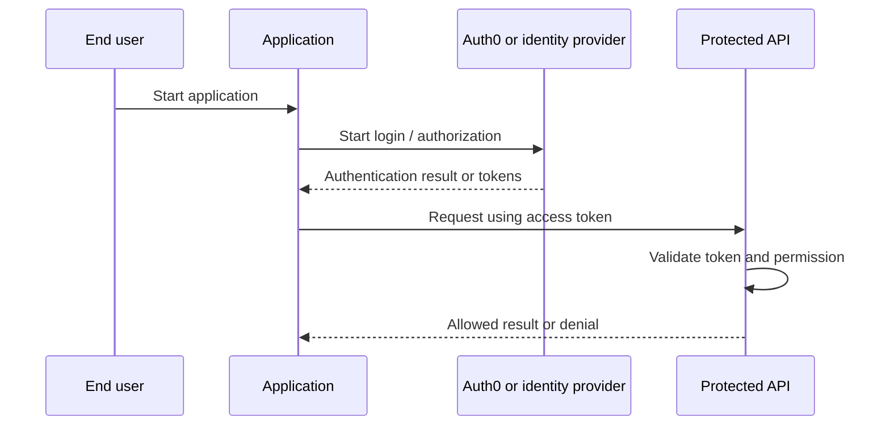
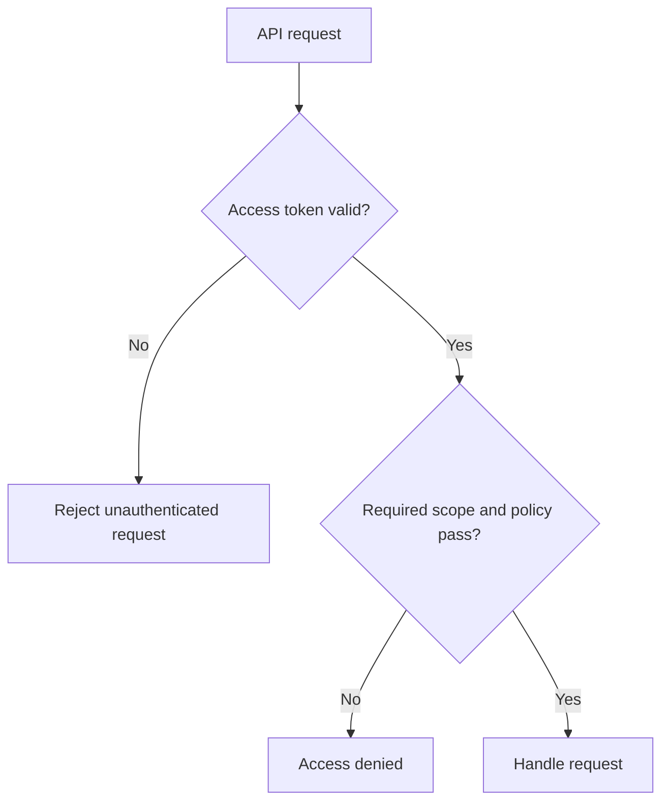

# Introduction to Auth0 — Explained Simply

*OAuth and Identity Study Library · Author: Jayesh Sharma*

**Based on:** [Auth0 Docs — Introduction to Auth0](https://auth0.com/docs/get-started/identity-fundamentals/introduction-to-auth0)

> Independently written study notes grounded in the linked Auth0 section. Diagrams, examples and interview tips are original explanatory additions rather than quotations. This chapter belongs to the Auth0 **Identity Fundamentals** documentation group.

## Contents

- [What this section teaches](#what-this-section-teaches)
- [Simple analogy](#simple-analogy)
- [The core architecture](#the-core-architecture)
- [Tenant and applications](#tenant-and-applications)
- [Users and connections](#users-and-connections)
- [API as resource server](#api-as-resource-server)
- [Universal Login](#universal-login)
- [Tokens and security](#tokens-and-security)
- [Deployment mindset](#deployment-mindset)
- [Practical learning exercise](#practical-learning-exercise)
- [Common mistakes and interview questions](#common-mistakes-and-interview-questions)

## What this section teaches

**Identity platform in front of applications.** Auth0 can provide login, token issuance, user connections and policy-related integrations so teams do not need to implement every login mechanism independently.

The central idea is to recognize the **identity**, **application**, **authorization server**, **resource server**, and **trust boundaries**. These concepts remain useful whether your implementation is Java/Spring Boot, C++, C#, Python or a web application.

## Simple analogy

A hotel reception desk validates a guest's reservation and identity, while door locks and room policies still decide what the guest may enter.

The analogy does not replace real token validation, session protection or authorization checks.

## The core architecture

## Tenant and applications

An Auth0 tenant is the administrative identity environment. Register a distinct application configuration for the client using login, such as a regular web app, SPA or native client.

**Think about it:** What might fail if the caller uses a valid credential but requests the wrong audience, scope or resource?

## Users and connections

A connection determines where identities are verified: Auth0 database, enterprise federation, social identity provider or a supported passwordless method.

**Think about it:** What might fail if the caller uses a valid credential but requests the wrong audience, scope or resource?

## API as resource server

Register the target API with an audience identifier. Applications request appropriate access and the API itself validates the access token and permission requirements.

**Think about it:** What might fail if the caller uses a valid credential but requests the wrong audience, scope or resource?

## Universal Login

Hosted login helps centralize the authentication user experience. Configure exact callback URLs, logout URLs, branding and MFA as needed.

**Think about it:** What might fail if the caller uses a valid credential but requests the wrong audience, scope or resource?

## Tokens and security

An ID token communicates authentication information to the client; an access token authorizes API access. Never treat an ID token as an API access token.

**Think about it:** What might fail if the caller uses a valid credential but requests the wrong audience, scope or resource?

## Deployment mindset

Separate development and production tenant configuration, automate changes where feasible and monitor failures without recording tokens or passwords.

**Think about it:** What might fail if the caller uses a valid credential but requests the wrong audience, scope or resource?

## Practical learning exercise

1. Draw the actors and label which component authenticates and which component authorizes.
2. Register an application and API in a safe Auth0 development tenant only if needed.
3. Configure exact callback URLs and requested scopes; never paste client secrets or access tokens into public repositories.
4. Test a valid login, an expired token, a wrong-audience token and an insufficient-permission request.
5. Compare application logs with expected 401/403 behavior and avoid logging sensitive data.

## Common mistakes and interview questions

| Common mistake | Better approach |
|---|---|
| Confusing a signed-in user with a fully authorized user | Check permissions per operation |
| Using ID tokens as API bearer tokens | Validate an access token with correct audience |
| Putting secrets in a public client | Use appropriate public-client OAuth flow with PKCE |
| Trusting a decoded JWT without verification | Validate signature, issuer, audience and expiry |
| Hardcoding everything into a demo | Separate application registration, roles and APIs |

**Practice:** Explain introduction to auth0 in 60 seconds. Who is authenticated? What resource is protected? Which service enforces access? What error is expected when permission is missing?

**Source:** https://auth0.com/docs/get-started/identity-fundamentals/introduction-to-auth0
