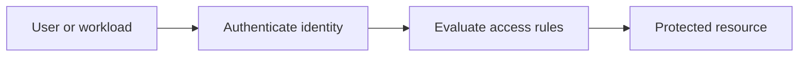
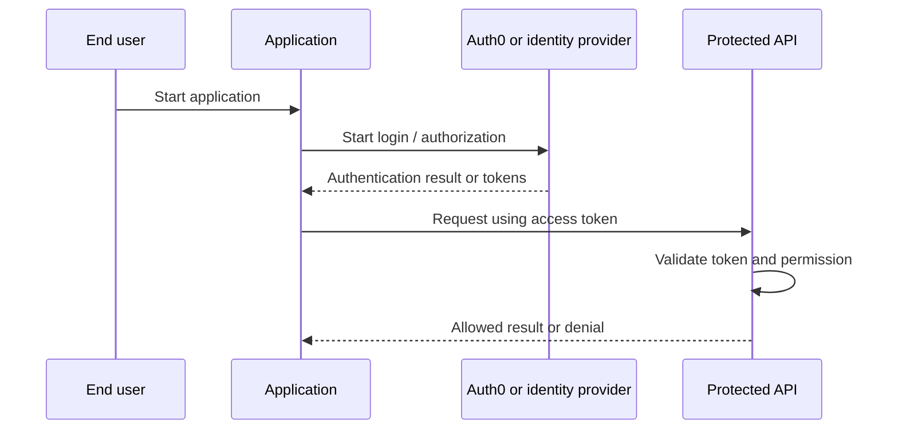
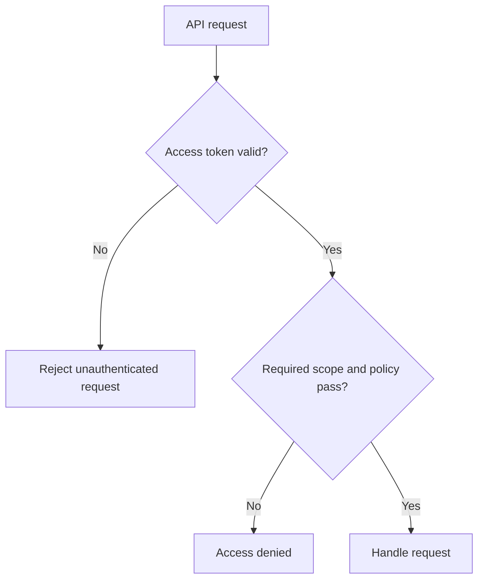

# Introduction to Identity and Access Management (IAM) — Explained Simply

*OAuth and Identity Study Library · Author: Jayesh Sharma*

**Based on:** [Auth0 Docs — Introduction to Identity and Access Management (IAM)](https://auth0.com/docs/get-started/identity-fundamentals/identity-and-access-management)

## Contents

- [What this section teaches](#what-this-section-teaches)
- [Simple analogy](#simple-analogy)
- [The core architecture](#the-core-architecture)
- [Digital identities](#digital-identities)
- [Authentication and authorization](#authentication-and-authorization)
- [Identity providers](#identity-providers)
- [Authentication factors](#authentication-factors)
- [Standards](#standards)
- [Access management](#access-management)
- [Practical learning exercise](#practical-learning-exercise)
- [Common mistakes and interview questions](#common-mistakes-and-interview-questions)

## What this section teaches

**Identity and access control fundamentals.** IAM manages digital identities, how they prove who they are, and what access is permitted to apps, APIs, data and devices.

The central idea is to recognize the **identity**, **application**, **authorization server**, **resource server**, and **trust boundaries**. These concepts remain useful whether your implementation is Java/Spring Boot, C++, C#, Python or a web application.

## Simple analogy

An office guard checks a badge; separate building locks control which rooms the person can enter.

The analogy does not replace real token validation, session protection or authorization checks.

## The core architecture

## Digital identities

An identity can represent a person, an application, a device or a service. The identity record is not by itself proof that the caller owns it.

**Think about it:** What might fail if the caller uses a valid credential but requests the wrong audience, scope or resource?

## Authentication and authorization

Authentication answers who is calling. Authorization checks what this caller may do to a particular resource. They are separate decisions.

**Think about it:** What might fail if the caller uses a valid credential but requests the wrong audience, scope or resource?

## Identity providers

An IdP authenticates users and may provide attributes or claims to an application. Federation avoids each application managing a new password database.

**Think about it:** What might fail if the caller uses a valid credential but requests the wrong audience, scope or resource?

## Authentication factors

Knowledge includes password or PIN; possession includes security key or device; inherence includes biometrics. MFA combines distinct factors.

**Think about it:** What might fail if the caller uses a valid credential but requests the wrong audience, scope or resource?

## Standards

OAuth 2.0 focuses on delegated authorization, OpenID Connect adds identity sign-in, SAML is common in enterprise federation, and JWT is a token format.

**Think about it:** What might fail if the caller uses a valid credential but requests the wrong audience, scope or resource?

## Access management

RBAC assigns permissions to roles; finer-grained authorization considers resource, relation or context. Audit, MFA and step-up checks reduce risk.

**Think about it:** What might fail if the caller uses a valid credential but requests the wrong audience, scope or resource?

## Practical learning exercise

1. Draw the actors and label which component authenticates and which component authorizes.
2. Register an application and API in a safe Auth0 development tenant only if needed.
3. Configure exact callback URLs and requested scopes; never paste client secrets or access tokens into public repositories.
4. Test a valid login, an expired token, a wrong-audience token and an insufficient-permission request.
5. Compare application logs with expected 401/403 behavior and avoid logging sensitive data.

## Common mistakes and interview questions

| Common mistake | Better approach |
|---|---|
| Confusing a signed-in user with a fully authorized user | Check permissions per operation |
| Using ID tokens as API bearer tokens | Validate an access token with correct audience |
| Putting secrets in a public client | Use appropriate public-client OAuth flow with PKCE |
| Trusting a decoded JWT without verification | Validate signature, issuer, audience and expiry |
| Hardcoding everything into a demo | Separate application registration, roles and APIs |

**Practice:** Explain introduction to identity and access management (iam) in 60 seconds. Who is authenticated? What resource is protected? Which service enforces access? What error is expected when permission is missing?

**Source:** https://auth0.com/docs/get-started/identity-fundamentals/identity-and-access-management
