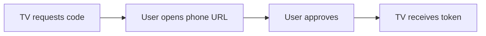
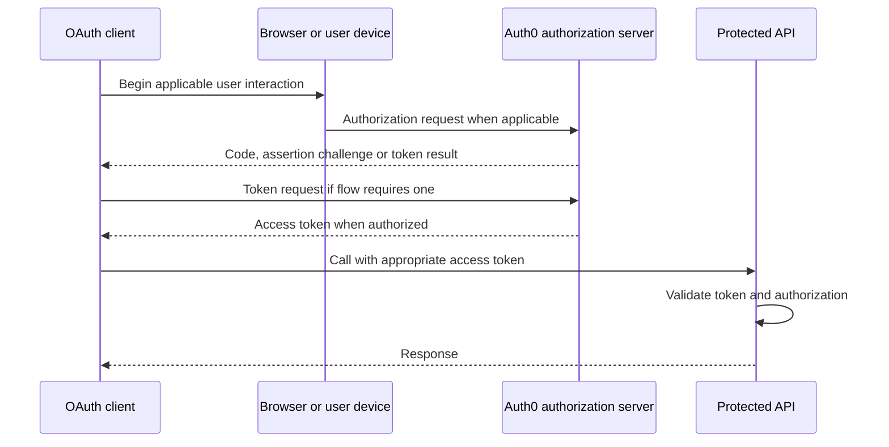
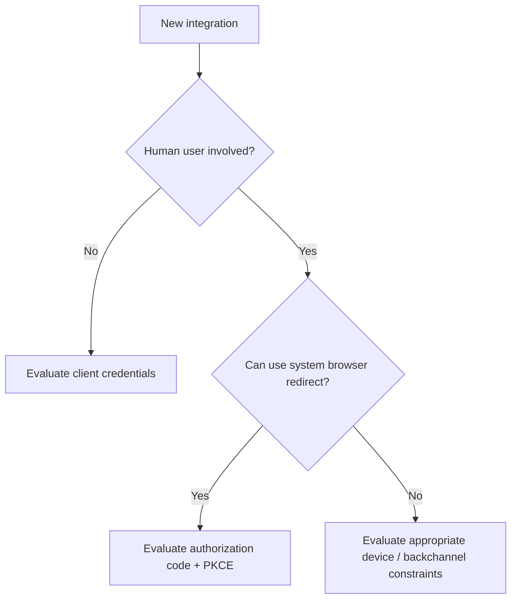

# Device Authorization Flow — Explained Simply

*OAuth and Identity Study Library · Author: Jayesh Sharma*

**Category:** Authentication and Authorization Flows  
**Source:** [Auth0 documentation](https://auth0.com/docs/get-started/authentication-and-authorization-flow)

> This is an original beginner-friendly explanation based on Auth0's public documentation. It does not copy the source article. The diagrams and interview examples are supplementary explanations.

## 1. What problem does it solve?

**Sign in on a device without a convenient keyboard.** A TV or command-line tool displays a code and verification URL. The user completes sign-in on another device; the original device polls until approval or timeout.

## 2. The central concept

Respect polling intervals and expiry. Display which device is requesting consent and guard against phishing or code substitution.

## 3. Simple request path

## 4. A practical OAuth architecture

> **Note:** This sequence is a teaching overview covering several grant families; it is **not** the precise wire protocol for every flow. For example, a pure client-credentials grant has no browser-based user interaction, and a device flow uses user-code and polling steps. Use the focused flowchart above and the official source for exact requests.

## 5. Important terms

| Term | Meaning |
|---|---|
| Client | The application requesting access |
| Authorization server | Auth0, which evaluates the grant and issues tokens |
| Resource owner | Usually the person whose data is protected; not present in every M2M grant |
| Resource server | API that accepts and validates access tokens |
| Scope | Requested category of delegated access |
| Audience | Intended API recipient of the access token |
| Access token | Credential for invoking a protected resource |
| ID token | OIDC client-facing proof of an authentication event; not an API access token |
| PKCE | Code binding protection, relevant to authorization-code grants |

## 6. Flow selection and security

Ask **who runs the client**, **where it runs**, **whether a human signs in**, and **whether it can protect credentials**.

This is a simplified selection aid, not a replacement for the individual specifications. Prefer authorization-code with PKCE for modern interactive clients. Do not give a public client a permanent client secret.

## 7. Common mistakes and troubleshooting

- Do not assume that a successful token response grants every API permission.
- Check token issuer, audience, signature, expiry and authorized scope at the resource server.
- Protect state and PKCE verifier in browser-based authorization-code flows.
- Do not log access tokens, credentials, private-key assertions or client certificates.
- Match redirect URIs precisely and handle authorization errors and cancellations.
- Separate authentication failures from permission denials; avoid granting broader permissions to “fix” a misconfigured request.

## 8. Interview and revision questions

1. Which application types benefit from **Device Authorization Flow**?
2. Which entity is authenticated: end user, client, or both?
3. What is transported in front-channel browser redirects, and what belongs at the token endpoint?
4. What happens when a token is replayed or used with the wrong audience?
5. What alternatives are recommended for new applications?

**Summary:** A TV or command-line tool displays a code and verification URL. The user completes sign-in on another device; the original device polls until approval or timeout.

**Original reference:** https://auth0.com/docs/get-started/authentication-and-authorization-flow
