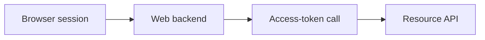
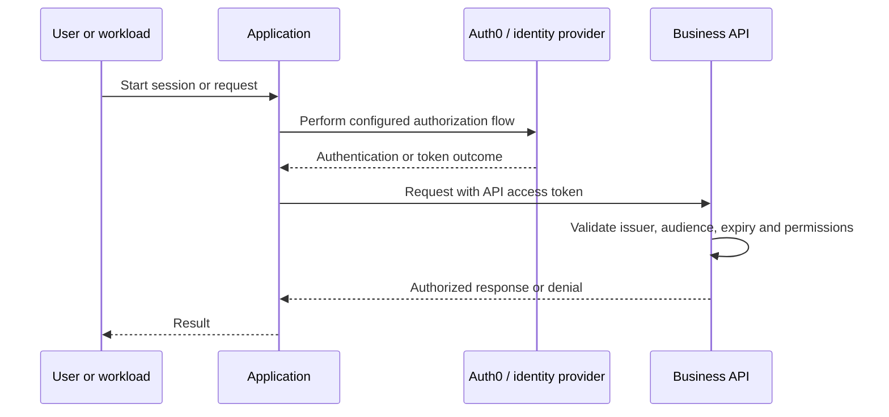
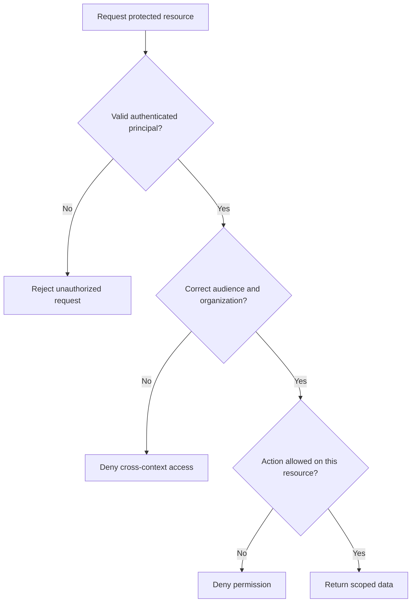

# Server Application with API — Explained Simply

*OAuth and Identity Study Library · Author: Jayesh Sharma*

**Documentation group:** Architecture Scenarios  
**Primary source:** [Auth0 — Server Application with API](https://auth0.com/docs/get-started/architecture-scenarios/server-application-api)

> Original teaching notes based on the public Auth0 article. Architecture diagrams and implementation examples are independently authored. The full contents of linked downloadable files or extended external resources are not assumed unless explicitly documented here.

## 1. Business problem

**A traditional server-rendered web front end calling a protected API.** A web server receives the browser's session cookie, then obtains or uses the correct access token when calling a backend API.

## 2. Design approach

Keep sensitive tokens server-side where possible. Validate the browser session and secure CSRF boundaries; validate access tokens and permissions again at the API.

## 3. High-level architecture

For real applications, identify which step is authentication, which step exchanges an authorization grant, and which service evaluates **application-specific permissions**.

## 4. Typical login and API request sequence

> The sequence is a **conceptual pattern**. An M2M application has no interactive end-user login; federated SSO may include an enterprise identity provider; and mobile/SPA clients must use public-client security protections. Use the linked reference for scenario-specific configuration.

## 5. Key decisions for architects

| Design question | Reason |
|---|---|
| Who owns user identities? | Determines directory connections, migration and account recovery |
| Which client type is used? | Determines appropriate OAuth/OIDC grant and credential protection |
| Which application or organization is active? | Prevents access across unrelated tenants or workspaces |
| Which API audience is intended? | Prevents accepting tokens issued for the wrong resource |
| Which authorization policies apply? | Prevents signed-in users reading other users' data |
| Where do sessions live? | Controls cookie settings, expiry and logout behavior |
| What is logged? | Enables incident response without exposing credentials or private data |

## 6. Authorization boundary

## 7. Practical implementation exercise

1. Identify the user population, apps, APIs and their owner organizations.
2. Decide where passwords and identity attributes are verified.
3. Register the right Auth0 application types; choose a compatible OAuth/OIDC flow.
4. Define API permissions and test a call with a wrong audience and missing permissions.
5. Add observability for login failures, token verification and access denials.
6. Test logout, expiry, account revocation, cross-organization boundaries and MFA.
7. Document the deployment and rollback plan; keep secrets and real tokens out of GitHub.

## 8. Common mistakes

- Treating one global signed-in session as permission to access every tenant.
- Relying on a role displayed in the UI without back-end authorization checks.
- Using an ID token to invoke an API.
- Failing to verify issuer, audience, signature or expiry.
- Sharing application secrets with browser/mobile clients.
- Assuming SSO automatically logs the user out of every application.
- Failing to test token/key rotation and identity provider outages.

## 9. Interview questions

1. What is the business problem solved by **Server Application with API**?
2. Which identity providers and OAuth/OIDC client types would you choose?
3. Where is the application’s permission decision enforced?
4. How would you prevent cross-tenant access and unauthorized token reuse?
5. What changes if the identity provider is temporarily unavailable?
6. How would you validate the design before production deployment?

**One-minute takeaway:** A web server receives the browser's session cookie, then obtains or uses the correct access token when calling a backend API.

**Official reference:** https://auth0.com/docs/get-started/architecture-scenarios/server-application-api
